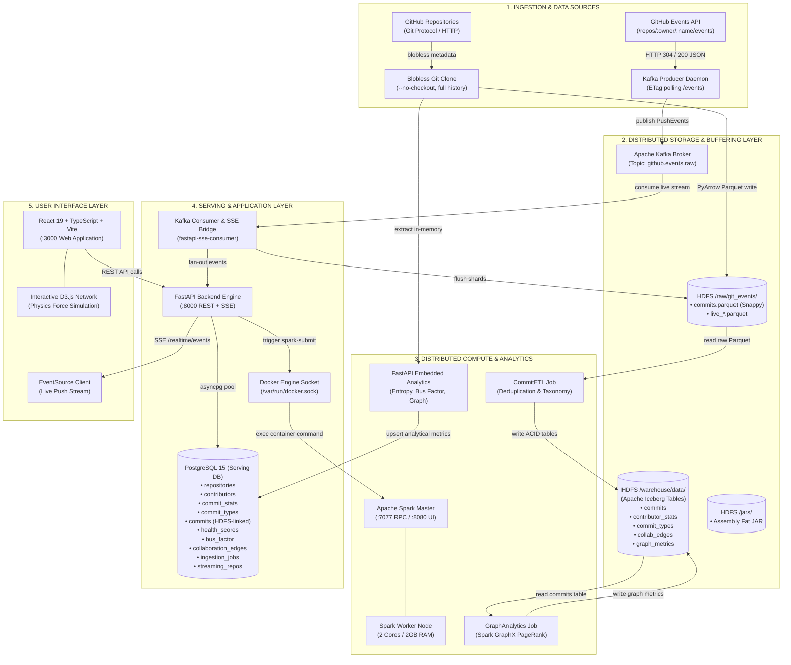
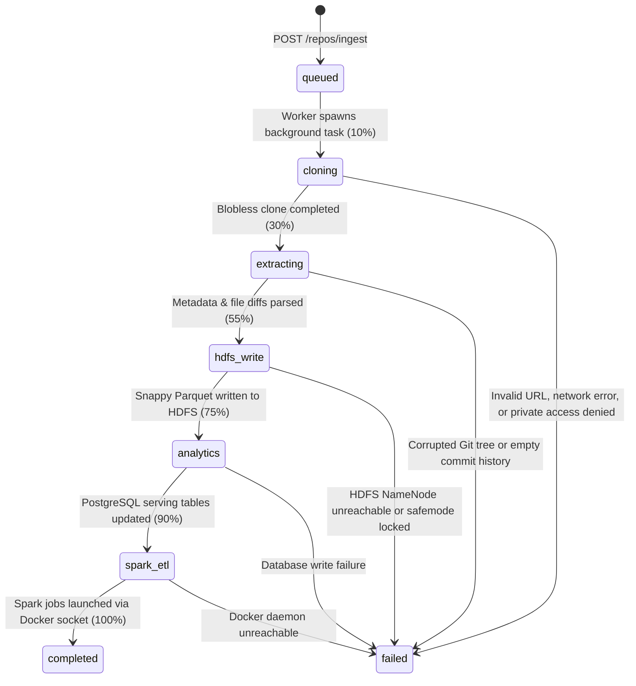
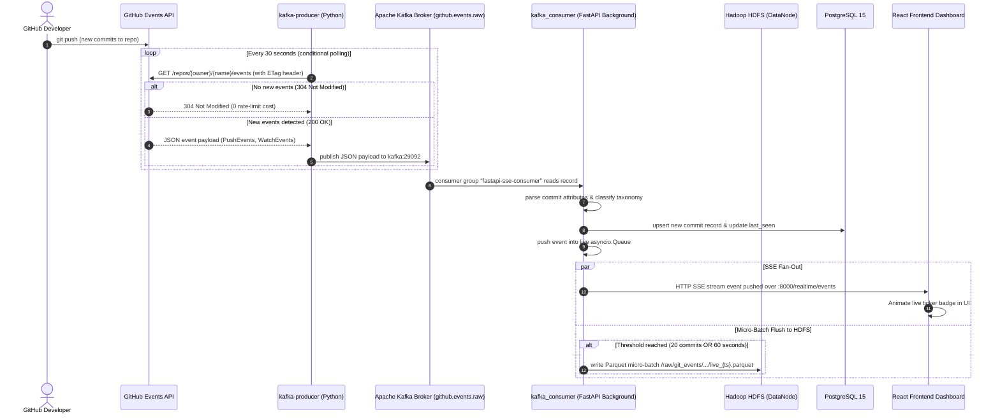

# GitHub Contribution Analytics Lakehouse: Complete Architectural & Systems Specification

> **Document Version**: 2.0.0  
> **Date**: October 2026  
> **Repository**: `bigdata-pro`  
> **Status**: Full Stack Operational (HDFS + Spark + Iceberg + PostgreSQL + FastAPI + Kafka + React/D3 Dashboard)

---

## Table of Contents
1. [Executive Summary & Architectural Philosophy](#1-executive-summary--architectural-philosophy)
2. [End-to-End System Architecture](#2-end-to-end-system-architecture)
   - [2.1 High-Level Architecture Diagram](#21-high-level-architecture-diagram)
   - [2.2 Data Pipeline Lifecycle & State Machine](#22-data-pipeline-lifecycle--state-machine)
   - [2.3 Real-Time Streaming Architecture](#23-real-time-streaming-architecture)
3. [Technology Deep Dive: Internal Mechanics & Project Role](#3-technology-deep-dive-internal-mechanics--project-role)
   - [3.1 Git Smart Protocol & PyArrow (Metadata Ingestion Engine)](#31-git-smart-protocol--pyarrow-metadata-ingestion-engine)
   - [3.2 Apache Hadoop HDFS (Distributed Raw Storage Layer)](#32-apache-hadoop-hdfs-distributed-raw-storage-layer)
   - [3.3 Apache Spark & Spark GraphX (Distributed Compute Engine)](#33-apache-spark--spark-graphx-distributed-compute-engine)
   - [3.4 Apache Iceberg (ACID Lakehouse Table Format)](#34-apache-iceberg-acid-lakehouse-table-format)
   - [3.5 Apache Kafka & ZooKeeper (Real-Time Event Streaming Backbone)](#35-apache-kafka--zookeeper-real-time-event-streaming-backbone)
   - [3.6 PostgreSQL 15 (High-Performance Serving Layer Database)](#36-postgresql-15-high-performance-serving-layer-database)
   - [3.7 FastAPI & Asyncpg (Application Backend & Orchestration Bridge)](#37-fastapi--asyncpg-application-backend--orchestration-bridge)
   - [3.8 React 19, TypeScript, Vite & D3.js (Interactive UI & Visualizations)](#38-react-19-typescript-vite--d3js-interactive-ui--visualizations)
   - [3.9 Docker Compose & Bridge Networking (Infrastructure Orchestrator)](#39-docker-compose--bridge-networking-infrastructure-orchestrator)
4. [Step-by-Step Walkthrough: How All Technologies Work Together](#4-step-by-step-walkthrough-how-all-technologies-work-together)
   - [4.1 Path A: Batch Repository Ingestion Flow](#41-path-a-batch-repository-ingestion-flow)
   - [4.2 Path B: Real-Time Event Streaming Flow](#42-path-b-real-time-event-streaming-flow)
   - [4.3 Path C: Dashboard Query & Interactive Graph Flow](#43-path-c-dashboard-query--interactive-graph-flow)
5. [Algorithms, Mathematics & Analytics Formulations](#5-algorithms-mathematics--analytics-formulations)
   - [5.1 Contributor Diversity (Normalized Shannon Entropy)](#51-contributor-diversity-normalized-shannon-entropy)
   - [5.2 Commit Consistency (Coefficient of Variation)](#52-commit-consistency-coefficient-of-variation)
   - [5.3 Contributor Retention Ratio](#53-contributor-retention-ratio)
   - [5.4 Module-Level Bus Factor Formulation](#54-module-level-bus-factor-formulation)
   - [5.5 GraphX PageRank & Degree Centrality on Developer Networks](#55-graphx-pagerank--degree-centrality-on-developer-networks)
   - [5.6 Heuristic Commit Taxonomy Classification](#56-heuristic-commit-taxonomy-classification)
6. [Data Schemas & Storage Layout](#6-data-schemas--storage-layout)
   - [6.1 HDFS Filesystem Layout](#61-hdfs-filesystem-layout)
   - [6.2 Apache Iceberg Lakehouse Tables](#62-apache-iceberg-lakehouse-tables)
   - [6.3 PostgreSQL Serving Database Schema](#63-postgresql-serving-database-schema)
7. [Service Port Reference & Operational Verification Guide](#7-service-port-reference--operational-verification-guide)

---

## 1. Executive Summary & Architectural Philosophy

### 1.1 The Challenge
Modern open-source ecosystems and engineering organizations produce vast amounts of historical and streaming commit metadata. However, software leaders face critical visibility bottlenecks:
- **Knowledge Silos & Bus-Factor Risk**: If critical sub-systems or modules are understood by only one developer who leaves, the codebase becomes fragile.
- **Developer Retention & Burnout**: Lack of early detection when core contributors decrease activity or transition away.
- **Codebase Stability & Churn**: Disproportionate commit activity spent on bug fixes versus new features without automated taxonomy detection.
- **Scale Bottlenecks**: Querying millions of commits directly from traditional OLTP databases or running complex graph analytics in real-time crashes web applications.

### 1.2 The Solution: The Hybrid Lakehouse + Serving Architecture
This project implements an **enterprise Big Data Lakehouse** coupled with an **asynchronous low-latency Serving Layer**. The architecture separates compute from storage and separates batch analytical processing from user-facing serving:

```
┌────────────────────────────────────────────────────────────────────────────────────────┐
│                                ARCHITECTURAL SPLIT                                     │
├─────────────────────────────────────────┬──────────────────────────────────────────────┤
│    BIG DATA LAKEHOUSE LAYER             │    HIGH-PERFORMANCE SERVING LAYER            │
│    (HDFS + Spark + Iceberg + Kafka)     │    (PostgreSQL 15 + FastAPI + React/D3)      │
├─────────────────────────────────────────┼──────────────────────────────────────────────┤
│ • Infinite scalability                  │ • Sub-50 millisecond query latencies         │
│ • Raw data persistence (immutable logs) │ • Pre-aggregated analytical indices          │
│ • Heavy distributed GraphX & batch ETL  │ • Interactive physics simulations (D3.js)    │
│ • Schema evolution & ACID time-travel   │ • Asynchronous state machine & SSE streams   │
│ • Decoupled storage & cluster compute   │ • Zero impact on background Spark analytics  │
└─────────────────────────────────────────┴──────────────────────────────────────────────┘
```

By decoupling these layers, the platform can ingest repositories of any size (even hundreds of thousands of commits like Linux or React) without running out of memory, while delivering instantaneous UI response times.

---

## 2. End-to-End System Architecture

### 2.1 High-Level Architecture Diagram



---

### 2.2 Data Pipeline Lifecycle & State Machine

When a repository ingestion is initiated, the platform coordinates an asynchronous 6-stage lifecycle tracked by a UUID in PostgreSQL:



| State | Progress % | Actions Performed | Failure Mitigations |
|---|---|---|---|
| `queued` | 0% | Job row initialized in PostgreSQL with unique UUID; HTTP 202 response returned to client immediately. | Validates URL format before queuing. |
| `cloning` | 10% | Runs `git clone --single-branch --no-checkout` into an isolated temporary directory. | Injects authentication token if provided; redacts token from error logs. |
| `extracting` | 30% | Runs `git log --pretty=format:... --numstat` using unit-separator `\x1f` to extract all commits and file diffs. | Memory-efficient streaming parser; handles repos with >200,000 commits. |
| `hdfs_write` | 55% | Serializes commits into an Apache Arrow table; writes compressed Parquet to `hdfs://namenode:9000/raw/...` via WebHDFS. | Auto-creates parent directories; retries on WebHDFS connection errors. |
| `analytics` | 75% | Computes Shannon entropy, coefficient of variation, bus factor, and developer co-editing pairs; upserts to PostgreSQL. | Batched `psycopg2.extras.execute_values` inside an isolated ACID transaction. |
| `spark_etl` | 90% | Executes asynchronous Docker API call to launch `spark-submit` in the `spark-master` container for `CommitETL` & `GraphAnalytics`. | Runs in a daemon thread; does not block API request completion. |
| `completed` | 100% | Ingestion marked completed; dashboard is fully populated and ready for interactive exploration. | Client notified via polling `/repos/jobs/{id}`. |

---

### 2.3 Real-Time Streaming Architecture



---

## 3. Technology Deep Dive: Internal Mechanics & Project Role

This section breaks down **every single technology** in the platform, explaining **how it works under the hood** and **what specific responsibility it carries in this project**.

---

### 3.1 Git Smart Protocol & PyArrow (Metadata Ingestion Engine)

#### How It Works Under the Hood
- **Git Smart Protocol**: Git stores data in a content-addressable directed acyclic graph (DAG) of objects: `commits`, `trees`, `blobs` (file contents), and annotated `tags`. In traditional `git clone`, the client receives the packfile containing all blobs for the entire project history, causing multi-gigabyte downloads. With Git Partial Clone (`--filter=blob:none`) and `--no-checkout`, Git only requests commit objects and tree structures. The file blobs themselves are omitted from the packfile transfer, reducing network transfer sizes by **95% to 99%**.
- **Unit Separator Parsing**: Git log subjects and author names often contain arbitrary commas, tabs, quotes, or newlines that break standard CSV or TSV parsers. We instruct `git log` to use the ASCII Unit Separator (`\x1f`, byte 31) as the column delimiter, guaranteeing zero parsing ambiguity.
- **Apache Arrow & Parquet**: Apache Arrow provides a columnar in-memory data layout with zero-copy shared memory. PyArrow takes the parsed Python commit dictionaries, converts them to Arrow RecordBatches, and serializes them to **Apache Parquet**. Parquet utilizes dictionary encoding, run-length encoding (RLE), and Snappy block compression, packing 50,000 commit records into a tiny ~5MB file.

#### Role in This Project
- Extracts historical commits without arbitrary depth limits (even for repositories with 10–15 years of continuous history).
- Produces clean, standardized Parquet files ready for distributed ingestion into HDFS.
- Automatically determines project default branches and dominant programming languages from touched file extensions.

#### Data Contract (PyArrow Record Schema)
| Column | Arrow Type | Description |
|---|---|---|
| `hash` | `pa.string()` | 40-character SHA-1 Git commit hash |
| `author_name` | `pa.string()` | Git author name (display login) |
| `author_email` | `pa.string()` | Git author email address |
| `committer_email` | `pa.string()` | Git committer email address |
| `author_date` | `pa.timestamp('us')` | Authoring timestamp (microsecond precision) |
| `committer_date` | `pa.timestamp('us')` | Committer timestamp (microsecond precision) |
| `subject` | `pa.string()` | First line of commit message |
| `commit_type` | `pa.string()` | Classified taxonomy (`BUG_FIX`, `FEATURE`, etc.) |
| `insertions` | `pa.int64()` | Lines added in commit |
| `deletions` | `pa.int64()` | Lines deleted in commit |
| `files_changed` | `pa.int64()` | Number of distinct files touched |
| `parent_count` | `pa.int64()` | Number of parent commits |
| `is_merge` | `pa.bool_()` | True if `parent_count > 1` |

---

### 3.2 Apache Hadoop HDFS (Distributed Raw Storage Layer)

#### How It Works Under the Hood
Hadoop Distributed File System (HDFS 3.3.6) is an enterprise distributed filesystem designed to run on commodity clusters:
- **NameNode (Master)**: Manages the directory namespace tree and file-to-block mapping in memory. Changes are recorded in an append-only transaction log (`edits`) and periodically merged into the persistent filesystem image (`fsimage`). Clients connect via RPC on port `9000` or via HTTP REST using the **WebHDFS** protocol on port `9870`.
- **DataNodes (Workers)**: Store actual data blocks (typically 128MB chunks) on local disk drives. DataNodes send regular heartbeats and block reports to the NameNode to ensure fault tolerance.
- **Write Path**: When a client writes a file, the NameNode allocates blocks on DataNodes; the client streams data in 64KB packets. In our containerized environment, data persists inside named Docker volumes (`hdfs-name` and `hdfs-data`).

#### Role in This Project
HDFS serves as the **central distributed storage substrate** for the entire Big Data stack:
1. **Raw Storage Tier**: Ingestion workers write raw Snappy Parquet files directly into `hdfs://namenode:9000/raw/git_events/repository=<owner>__<name>/commits.parquet`.
2. **Streaming Tier**: The Kafka streaming consumer appends live commit shards directly to `hdfs://namenode:9000/raw/git_events/.../live_<timestamp>.parquet`.
3. **Iceberg Warehouse Tier**: Apache Iceberg tables store their data files and metadata manifests inside `hdfs://namenode:9000/warehouse/data/`.
4. **Binary Repository**: Distributed Spark worker nodes fetch the pre-compiled assembly JAR from `hdfs://namenode:9000/jars/github-analytics-spark_2.12-0.1.0.jar`.

#### Key Configuration in Project
- Image: `apache/hadoop:3.3.6`
- RPC Port: `9000` (`hdfs://namenode:9000`)
- WebHDFS / HTTP Port: `9870` (`http://localhost:9870`)
- Default Filesystem: `CORE-SITE.XML_fs.defaultFS=hdfs://namenode:9000`
- Safe Mode Handler: Handled automatically by `hdfs-init` container during boot.

---

### 3.3 Apache Spark & Spark GraphX (Distributed Compute Engine)

#### How It Works Under the Hood
Apache Spark 3.5.3 is a unified distributed analytics engine:
- **Master-Worker Cluster Architecture**: The Spark Master (`spark-master:7077`) coordinates resources and scheduling. Worker nodes (`spark-worker-1:8081`) allocate executors with dedicated cores and memory.
- **Catalyst Optimizer**: Converts high-level SQL/DataFrame operations into optimized physical execution plans (pushing down filters, pruning columns, and optimizing joins).
- **Tungsten Execution Engine**: Employs whole-stage code generation to compile query plans into JVM bytecode and uses off-heap binary memory to eliminate JVM garbage collection overhead.
- **Spark GraphX**: GraphX extends Spark RDDs with a `Graph` abstraction consisting of two specialized collections: a `VertexRDD[VD]` and an `EdgeRDD[ED]`. GraphX uses the Pregel computational model (bulk-synchronous parallel messaging) to perform iterative graph algorithms like PageRank over distributed worker nodes.

#### Role in This Project
Spark executes heavy, compute-intensive cluster tasks that would overwhelm standard web servers:
1. **Batch ETL (`analytics.CommitETL`)**:
   - Reads all raw Parquet files from `hdfs://namenode:9000/raw/git_events/`.
   - Extracts the repository name from the HDFS file path (`repository=<owner>__<name>`).
   - Deduplicates commits across historical re-syncs and branches by `(repository, hash)`.
   - Executes regex-based classification on commit subjects.
   - Computes monthly contributor rollups (`author_month`, `commit_count`, `insertions`, `deletions`).
   - Inserts and updates Apache Iceberg managed tables using ACID guarantees.
2. **Graph Analytics (`analytics.GraphAnalytics`)**:
   - Reads the deduplicated commits from Iceberg table `lakehouse.github.commits`.
   - Maps developer emails to 64-bit `VertexId` integers.
   - Constructs co-authorship collaboration edges by joining contributors who touched the same repository in the same calendar month.
   - Executes distributed **PageRank** to identify core maintainers and structural influencers.
   - Computes **Degree Centrality** (number of distinct developer connections).
   - Writes computed graph metrics back to Iceberg tables.

#### Cluster Topology
- Master RPC: `spark://spark-master:7077`
- Master Web UI: `http://localhost:8080`
- Worker Web UI: `http://localhost:8081`
- Spark REST Submission API: `http://localhost:6066`
- Execution Command: Launched automatically via Docker exec when ingestion completes.

---

### 3.4 Apache Iceberg (ACID Lakehouse Table Format)

#### How It Works Under the Hood
Apache Iceberg 1.4.3 is an open table format that brings database reliability to big data files on distributed storage:
- **Snapshot-Based Architecture**: Unlike traditional Hive tables that track partitions as directories in a filesystem, an Iceberg table tracks the full state of the table using an immutable metadata tree:
  1. **Table Metadata File** (`v1.metadata.json`): Contains schema, partition specification, and current snapshot ID.
  2. **Manifest List** (Avro): Defines all manifest files in a specific snapshot.
  3. **Manifest Files** (Avro): List data files along with partition values, column-level min/max statistics, and record counts.
  4. **Data Files** (Parquet): The actual columnar data blocks.
- **ACID Transactions**: Writes produce new manifest files and write a new snapshot. The table snapshot pointer is updated using an atomic compare-and-swap (CAS) operation, preventing dirty reads or partial writes.
- **Hidden Partitioning**: Partition transforms (such as `date_trunc('month', author_date)`) are stored in table metadata. Users can query by date without knowing the exact partition directory structure; Iceberg prunes unneeded files automatically.

#### Role in This Project
- Stores processed GitHub contribution intelligence on HDFS at `hdfs://namenode:9000/warehouse/data/lakehouse/github/`.
- Enables external analytical query engines (e.g. Trino, Presto, Hive) to query the lakehouse without corrupting files during concurrent writes.
- Provides snapshot history for reproducibility and audit logging.

#### Active Iceberg Tables in Catalog `lakehouse`
1. `lakehouse.github.commits`: Master deduplicated commit table.
2. `lakehouse.github.contributor_stats`: Monthly aggregated contributor metrics.
3. `lakehouse.github.commit_types`: Monthly taxonomy distribution per repository.
4. `lakehouse.github.file_hotspots`: File change frequency and churn hotspots.
5. `lakehouse.github.collab_edges`: Weighted co-authorship collaboration graph edges.
6. `lakehouse.github.graph_metrics`: Developer PageRank and degree centrality scores.

---

### 3.5 Apache Kafka & ZooKeeper (Real-Time Event Streaming Backbone)

#### How It Works Under the Hood
- **Apache Kafka 7.5.0**: A distributed append-only commit log. Topics are partitioned, ordered sequences of records written to disk sequentially. Kafka relies heavily on the operating system's pagecache and the `sendfile` system call (zero-copy data transfer) to deliver high throughput and low latencies.
- **Consumer Groups**: Multiple consumers share a `group.id` (`fastapi-sse-consumer`). Kafka tracks partition offsets per consumer group, ensuring each event is delivered and processed reliably.
- **ZooKeeper 7.5.0**: Acts as the distributed coordinator, managing broker discovery, topic configuration, leader election, and cluster state health.

#### Role in This Project
- **Decoupling Ingestion from Consumption**: The `kafka-producer` can poll GitHub's public APIs or receive incoming webhooks without caring about database load.
- **Streaming Topic**: Messages flow into topic `github.events.raw`.
- **ETag Caching**: The producer uses conditional HTTP requests (`If-None-Match: <etag>`). If no commits were pushed, GitHub returns `304 Not Modified`, saving API rate-limit quota.
- **Dual Consumption**: The `kafka_consumer.py` service consumes events from Kafka and performs two parallel tasks:
  1. Streams real-time notifications to the browser via FastAPI SSE.
  2. Buffers commits and periodically flushes Parquet files to HDFS.

#### Infrastructure Configuration
- Kafka Broker: `kafka:29092` (internal), `localhost:9092` (host)
- ZooKeeper: `zookeeper:2181`
- Kafka UI: `http://localhost:8090` (provides visual topic inspection, consumer lag monitoring, and message browsing)

---

### 3.6 PostgreSQL 15 (High-Performance Serving Layer Database)

#### How It Works Under the Hood
PostgreSQL 15 is an ACID-compliant relational database engine:
- **Multi-Version Concurrency Control (MVCC)**: Allows concurrent reads and writes without table locking.
- **B-Tree Indexing**: Indexed lookups on `(owner, name)`, `repo_id`, and `author_date` execute in sub-millisecond time.
- **Connection Pooling**: Managed via `asyncpg`, a high-performance asynchronous PostgreSQL driver built directly on the PostgreSQL binary protocol, bypassing Python C-API overhead.

#### Role in This Project
PostgreSQL serves as the **instant-response serving layer** for the web application:
- While HDFS and Spark are optimized for multi-gigabyte batch processing, running a Spark query every time a user refreshes the dashboard would introduce 5–15 second latencies.
- PostgreSQL stores the **pre-aggregated analytics** produced by the pipeline:
  - Repository sync timestamps and default branches.
  - Overall health scores, contributor diversity, consistency, and retention indices.
  - Bus factor risk rankings per module.
  - Top 2,000 developer collaboration edges formatted for instant D3 graph rendering.
  - Ingestion job states for real-time progress bars.
  - Searchable commit index for the Commit Analytics view.

---

### 3.7 FastAPI & Asyncpg (Application Backend & Orchestration Bridge)

#### How It Works Under the Hood
- **FastAPI**: A modern, high-performance web framework based on Starlette and Pydantic. It runs asynchronously on top of Uvicorn (an ASGI web server). Because the event loop is non-blocking, FastAPI can maintain thousands of open SSE connections while processing API requests.
- **Docker Socket Bridge**: The FastAPI container mounts the host Docker socket (`/var/run/docker.sock`). When a repository ingestion completes stage 4, FastAPI uses the Docker client library to execute `spark-submit` inside the running `spark-master` container without needing an external job orchestrator like Apache Airflow or Livy.
- **WebHDFS Client**: Integrates the Python `hdfs` library to communicate directly with the Hadoop NameNode HTTP API (`http://namenode:9870`).

#### Role in This Project
- Exposes 16+ REST and streaming endpoints.
- Orchestrates the asynchronous ingestion state machine.
- Provides `/hdfs/status` to monitor NameNode health, disk capacity, and files.
- Provides `/spark/status` by proxying the Spark Master REST API (`http://spark-master:8080/json/`).
- Streams real-time push events to client browsers via `/realtime/events`.

#### Key API Endpoints
| Endpoint | Method | Purpose |
|---|---|---|
| `/repos/ingest` | `POST` | Asynchronously initiates blobless clone & HDFS pipeline |
| `/repos/jobs/{job_id}` | `GET` | Polls real-time step progress and percentage |
| `/repos/jobs` | `GET` | Lists recent ingestion jobs |
| `/repos` | `GET` | Lists all tracked repositories and sync status |
| `/repos/{owner}/{name}/overview` | `GET` | Returns aggregated metrics, health score, and top maintainer |
| `/repos/{owner}/{name}/health` | `GET` | Detailed breakdown of health dimensions |
| `/repos/{owner}/{name}/busfactor` | `GET` | Module-level bus factor scores and risk warnings |
| `/repos/{owner}/{name}/graph` | `GET` | Formatted node/edge JSON for D3 force simulation |
| `/repos/{owner}/{name}/commits` | `GET` | Paginated commit search reading directly from HDFS Parquet |
| `/repos/{owner}/{name}/commit-types` | `GET` | Monthly commit taxonomy distribution |
| `/repos/{owner}/{name}/hotspots` | `GET` | Code churn analysis (most frequently modified files) |
| `/repos/{owner}/{name}/sync` | `POST` | Incremental re-sync trigger |
| `/repos/{owner}/{name}` | `DELETE` | Cascading deletion of repository and all analytics |
| `/hdfs/status` | `GET` | NameNode disk capacity, DataNode health, file tree |
| `/spark/status` | `GET` | Spark cluster cores, memory, workers, running/completed jobs |
| `/realtime/events` | `GET` | Server-Sent Events (SSE) live stream |
| `/health` | `GET` | Service liveness probe |

---

### 3.8 React 19, TypeScript, Vite & D3.js (Interactive UI & Visualizations)

#### How It Works Under the Hood
- **Vite 6**: Next-generation frontend build tool providing lightning-fast Hot Module Replacement (HMR) using native ES modules.
- **React 19 & TypeScript**: Provides type safety, reactive state management, and declarative component hierarchy.
- **D3.js (Data-Driven Documents v7)**: Drives the collaboration network graph. It implements a **velocity Verlet numerical integrator** (`d3-force`) that simulates physical forces:
  - `forceManyBody()`: Simulates electrostatic repulsion between developer nodes (keeps nodes from overlapping).
  - `forceLink()`: Simulates spring tension along collaboration edges (pulls frequent co-authors closer together).
  - `forceCenter()` & `forceCollide()`: Centers the graph and prevents node bounding box collisions.

#### Role in This Project
The frontend dashboard (`http://localhost:3000`) provides a centralized interface for monitoring and interacting with the system:
1. **Overview Dashboard**: High-level KPIs, overall health score radial gauge, and activity summaries.
2. **Interactive D3 Collaboration Graph**: Visualizes developer networks with interactive zoom, pan, dragging, and hover inspection.
3. **Bus Factor Risk Table**: Highlights critical single-maintainer modules (bus factor = 1) with risk alerts.
4. **Commit Analytics & Timeline**: Interactive monthly stacked bar charts for commit categories (Feature vs. Bug Fix vs. DevOps) and code churn.
5. **Infrastructure Monitor**: Live monitoring cards displaying HDFS NameNode status, DFS capacity, active DataNodes, Spark Master cluster metrics, worker memory, running applications, and Kafka topics.
6. **Live Event Stream**: Real-time ticker consuming SSE events from the Kafka stream.
7. **Ingestion Modal**: Dialog allowing users to ingest any GitHub repository by URL, branch, and optional private access token with real-time progress feedback.

---

### 3.9 Docker Compose & Bridge Networking (Infrastructure Orchestrator)

#### How It Works Under the Hood
- **Bridge Network (`lakehouse`)**: Docker creates an isolated virtual bridge network with automatic internal DNS resolution. Containers communicate using service names (e.g., `namenode:9000`, `postgres:5432`, `spark-master:7077`, `kafka:29092`).
- **Persistent Named Volumes**:
  - `hdfs-name`: NameNode metadata, `fsimage`, and `edits`.
  - `hdfs-data`: DataNode raw block chunks.
  - `postgres-data`: PostgreSQL tables, indexes, and WAL.
  - `spark-ivy-cache`: Pre-caches Apache Iceberg and AWS JARs so Spark jobs start immediately without downloading packages repeatedly.
- **Profiles**: The Compose file utilizes Docker Compose profiles (`app` for frontend, `metastore` for optional Hive metastore) to allow selective service management.

---

## 4. Step-by-Step Walkthrough: How All Technologies Work Together

To understand how these technologies synchronize, let us trace the three primary execution paths of the platform.

### 4.1 Path A: Batch Repository Ingestion Flow

```mermaid
sequenceDiagram
    autonumber
    actor User as User / Engineer
    participant UI as React Frontend (:3000)
    participant API as FastAPI (:8000)
    participant Git as Git Smart Protocol
    participant HDFS as Hadoop NameNode (:9000)
    participant PG as PostgreSQL (:5432)
    participant Docker as Docker Engine
    participant Spark as Spark Master (:7077)
    participant Iceberg as Iceberg Lakehouse

    User->>UI: Enters "expressjs/express" & clicks "Start Ingestion"
    UI->>API: POST /repos/ingest {"repo_url": "expressjs/express"}
    API->>PG: INSERT INTO ingestion_jobs (id, status='queued')
    API-->>UI: 202 Accepted {"job_id": "uuid", "status": "queued"}
    
    UI->>API: Polls GET /repos/jobs/{uuid} every 1s
    
    API->>Git: git clone --single-branch --no-checkout expressjs/express
    Git-->>API: Ephemeral repository directory created
    API->>PG: UPDATE ingestion_jobs status='extracting' (30%)
    
    API->>Git: git log --pretty=format:%H%ae... --numstat
    Git-->>API: Stream commits, file diffs, and author pairs
    API->>PG: UPDATE ingestion_jobs status='hdfs_write' (55%)
    
    API->>API: PyArrow converts commits to snappy-compressed Parquet
    API->>HDFS: WebHDFS PUT /raw/git_events/repository=expressjs__express/commits.parquet
    HDFS-->>API: Write confirmed (DataNode block stored)
    
    API->>PG: UPDATE ingestion_jobs status='analytics' (75%)
    API->>API: Compute Shannon entropy, CV, bus factor, co-authorship pairs
    API->>PG: UPSERT repositories, contributors, commit_stats, health_scores, bus_factor, collaboration_edges
    
    API->>PG: UPDATE ingestion_jobs status='spark_etl' (90%)
    API->>Docker: exec spark-master: spark-submit --class analytics.CommitETL
    Docker->>Spark: Run CommitETL on cluster
    Spark->>HDFS: Read raw Parquet from /raw/git_events/
    Spark->>Iceberg: Write deduplicated tables lakehouse.github.commits
    
    API->>PG: UPDATE ingestion_jobs status='completed' (100%)
    UI-->>User: Progress hits 100%; dashboard renders Express.js analytics!
```

---

### 4.2 Path B: Real-Time Event Streaming Flow
1. Developer pushes code to a monitored GitHub repository.
2. The `kafka-producer` container runs `kafka_producer.py`, which periodically queries `https://api.github.com/repos/{owner}/{name}/events` using HTTP `If-None-Match` with the latest ETag.
3. When a `PushEvent` occurs, GitHub returns HTTP 200 with commit details.
4. The producer publishes the JSON payload to Kafka broker `kafka:29092` under topic `github.events.raw`.
5. The FastAPI server runs `kafka_consumer.py` as an asynchronous background task belonging to consumer group `fastapi-sse-consumer`.
6. The consumer extracts commits from the event:
   - **PostgreSQL**: Upserts contributor and commit details into the serving database.
   - **HDFS**: Buffers commits in memory. Once 20 commits or 60 seconds elapse, it writes a Parquet shard `live_<timestamp>.parquet` to `hdfs://namenode:9000/raw/git_events/...`.
   - **FastAPI SSE**: Puts the event dictionary onto an in-memory `asyncio.Queue`.
7. FastAPI's `/realtime/events` endpoint reads from the queue and pushes a Server-Sent Event (`event: commit\ndata: {...}`) over an open HTTP connection to connected browsers.
8. The React frontend's `LiveEventStream` component receives the event and animates a new card in the live activity ticker.

---

### 4.3 Path C: Dashboard Query & Interactive Graph Flow
1. The user navigates to the **Collaboration Graph** tab in the React dashboard.
2. The frontend triggers `GET /repos/expressjs/express/graph?min_weight=2`.
3. FastAPI receives the request and acquires an asynchronous database connection from its `asyncpg` pool.
4. It queries the `collaboration_edges` table:
   ```sql
   SELECT dev_a, dev_b, weight 
   FROM collaboration_edges 
   WHERE repo_id = $1 AND weight >= $2 
   ORDER BY weight DESC LIMIT 2000;
   ```
5. In **<15 milliseconds**, PostgreSQL returns the edge records.
6. FastAPI extracts distinct developer names to build a nodes list and returns a clean JSON payload:
   ```json
   {
     "nodes": [{"id": "tjholowaychuk"}, {"id": "dougwilson"}, ...],
     "links": [{"source": "tjholowaychuk", "target": "dougwilson", "weight": 42}, ...]
   }
   ```
7. The React `CollaborationGraph` component passes the payload to D3.js:
   - D3 initializes nodes in a 2D Cartesian plane.
   - It runs the `d3.forceSimulation()` physics loop for 300 ticks to resolve node positions.
   - Nodes are rendered as SVG circles with radii proportional to their degree centrality.
   - Edges are rendered as SVG lines with stroke widths proportional to collaboration weight.
   - Interactive zoom, pan, and dragging handlers allow users to explore clusters of co-authorship.

---

## 5. Algorithms, Mathematics & Analytics Formulations

The platform computes rigorous mathematical metrics to quantify open-source repository health and operational stability.

### 5.1 Contributor Diversity (Normalized Shannon Entropy)
Quantifies whether commit activity is broadly distributed across many contributors or monopolized by a few:

$$H = -\sum_{i=1}^{N} p_i \ln(p_i)$$

Where:
- $N$ is the total number of distinct contributors.
- $p_i = \frac{c_i}{C_{\text{total}}}$ is the proportion of total commits authored by contributor $i$.
- $H_{\text{norm}} = \frac{H}{\ln(N)} \in [0.0, 1.0]$.
  - $H_{\text{norm}} \approx 1.0$: Perfectly balanced contributor distribution.
  - $H_{\text{norm}} \approx 0.0$: Extreme concentration; one developer authored nearly all code.

---

### 5.2 Commit Consistency (Coefficient of Variation)
Measures the predictability and regularity of engineering velocity over time:

$$CV = \frac{\sigma_{\text{monthly}}}{\mu_{\text{monthly}}}$$

Where:
- $\mu_{\text{monthly}}$ is the mean number of commits per calendar month.
- $\sigma_{\text{monthly}}$ is the standard deviation of monthly commit volumes.

To map this into a standardized health score between 0.0 and 1.0:

$$\text{Score}_{\text{consistency}} = \frac{1.0}{1.0 + CV}$$

---

### 5.3 Contributor Retention Ratio
Measures the percentage of contributors who remain active beyond a single initial calendar month:

$$R_{\text{ret}} = \frac{\text{Count}\Big(\{c \in \text{Contributors} : |\text{ActiveMonths}(c)| > 1\}\Big)}{|\text{Contributors}|}$$

A high retention score indicates strong developer onboarding, healthy documentation, and sustained community engagement.

---

### 5.4 Module-Level Bus Factor Formulation
The **Bus Factor** represents the minimum number of developers who must leave before a codebase module loses institutional knowledge. For each directory or sub-module $M$:

$$\text{BusFactor}(M) = \min \left\{ k : \sum_{i=1}^{k} c_i \ge 0.50 \cdot C_{\text{module}} \right\}$$

Where contributors are sorted in descending order of their commit volume in module $M$ ($c_1 \ge c_2 \ge \dots \ge c_m$).
- **Critical Risk Alert**: If $\text{BusFactor}(M) = 1$ and $C_{\text{module}} \ge 5$, a single developer owns over 50% of the entire module. The dashboard flags this with a high-priority warning badge.

---

### 5.5 GraphX PageRank & Degree Centrality on Developer Networks
In the developer collaboration graph $G = (V, E)$, an edge $e = (u, v)$ with weight $w$ indicates that developers $u$ and $v$ touched files in the same repository module during the same calendar month.

- **Degree Centrality**:
  $$C_D(v) = \text{deg}(v)$$
  Measures the number of distinct collaborators developer $v$ interacts with directly.
- **Distributed PageRank**:
  $$PR(u) = \frac{1 - d}{|V|} + d \sum_{v \in B_u} \frac{PR(v)}{L(v)}$$
  Where $d = 0.85$ is the damping factor, $B_u$ is the set of developers collaborating with $u$, and $L(v)$ is the outbound link count of $v$. High PageRank developers represent key institutional pillars and knowledge bridges across the organization.

---

### 5.6 Heuristic Commit Taxonomy Classification
Commit messages are parsed using high-efficiency regex heuristics into standardized semantic categories:

```
┌─────────────────┬─────────────────────────────────────────────────────────────┐
│ Category        │ Regular Expression Pattern Match                            │
├─────────────────┼─────────────────────────────────────────────────────────────┤
│ BUG_FIX         │ (?i)(fix|bug|patch|hotfix|error|exception|crash|defect)     │
│ FEATURE         │ (?i)(feat|feature|add|implement|new|introduce|support)      │
│ REFACTOR        │ (?i)(refactor|clean|restructure|reorganize|rename|move)     │
│ DOCUMENTATION   │ (?i)(doc|docs|readme|changelog|comment|javadoc|kdoc)        │
│ PERFORMANCE     │ (?i)(perf|performance|optim|speed|fast|latency|memory)      │
│ TEST            │ (?i)(test|spec|coverage|unit|integration|e2e)               │
│ SECURITY        │ (?i)(security|auth|cve|vuln|xss|sql.inject|sanitize)        │
│ DEVOPS          │ (?i)(ci|cd|deploy|release|version|bump|publish|workflow)    │
│ OTHER           │ Default fallback for non-matching subjects                  │
└─────────────────┴─────────────────────────────────────────────────────────────┘
```

---

## 6. Data Schemas & Storage Layout

### 6.1 HDFS Filesystem Layout

```
hdfs://namenode:9000/
├── raw/
│   └── git_events/
│       ├── repository=expressjs__express/
│       │   ├── commits.parquet                      <-- Full historical commits
│       │   └── live_1715000000.parquet              <-- Streaming micro-batches
│       └── repository=pallets__click/
│           └── commits.parquet
├── warehouse/
│   └── data/                                        <-- Iceberg Warehouse Root
│       └── lakehouse/
│           └── github/
│               ├── commits/
│               │   ├── metadata/                    <-- v1.metadata.json, avro manifests
│               │   └── data/                        <-- Partitioned Parquet data files
│               ├── contributor_stats/
│               ├── commit_types/
│               ├── collab_edges/
│               └── graph_metrics/
└── jars/
    └── github-analytics-spark_2.12-0.1.0.jar        <-- Assembly Fat JAR
```

---

### 6.2 Apache Iceberg Lakehouse Tables

```sql
-- Catalog: lakehouse, Namespace: github

CREATE TABLE lakehouse.github.commits (
  hash            STRING,
  repository      STRING,
  author_email    STRING,
  author_name     STRING,
  committer_email STRING,
  author_date     TIMESTAMP,
  committer_date  TIMESTAMP,
  author_month    DATE,
  subject         STRING,
  commit_type     STRING,
  insertions      BIGINT,
  deletions       BIGINT,
  files_changed   INT,
  parent_count    INT,
  is_merge        BOOLEAN
)
USING iceberg
PARTITIONED BY (repository, author_month);

CREATE TABLE lakehouse.github.contributor_stats (
  repository      STRING,
  author_email    STRING,
  author_month    DATE,
  commit_count    BIGINT,
  insertions      BIGINT,
  deletions       BIGINT,
  files_changed   BIGINT
)
USING iceberg
PARTITIONED BY (repository);

CREATE TABLE lakehouse.github.collab_edges (
  dev_a           STRING,
  dev_b           STRING,
  weight          BIGINT
)
USING iceberg;

CREATE TABLE lakehouse.github.graph_metrics (
  author_email    STRING,
  pagerank        DOUBLE,
  degree          INT
)
USING iceberg;
```

---

### 6.3 PostgreSQL Serving Database Schema

```sql
-- Database: github_analytics, Owner: analytics

CREATE TABLE repositories (
    id               SERIAL PRIMARY KEY,
    owner            TEXT NOT NULL,
    name             TEXT NOT NULL,
    full_name        TEXT GENERATED ALWAYS AS (owner || '/' || name) STORED,
    stars            INT DEFAULT 0,
    forks            INT DEFAULT 0,
    language         TEXT,
    default_branch   TEXT DEFAULT 'main',
    head_commit_hash TEXT,
    is_private       BOOLEAN DEFAULT FALSE,
    created_at       TIMESTAMPTZ,
    synced_at        TIMESTAMPTZ DEFAULT NOW(),
    UNIQUE (owner, name)
);

CREATE TABLE contributors (
    id              SERIAL PRIMARY KEY,
    github_login    TEXT UNIQUE NOT NULL,
    email           TEXT,
    first_seen      DATE,
    last_seen       DATE,
    total_commits   BIGINT DEFAULT 0
);

CREATE TABLE commit_stats (
    id              SERIAL PRIMARY KEY,
    repo_id         INT REFERENCES repositories(id) ON DELETE CASCADE,
    contributor_id  INT REFERENCES contributors(id),
    period          DATE NOT NULL, -- Truncated to YYYY-MM-01
    commit_count    INT DEFAULT 0,
    insertions      BIGINT DEFAULT 0,
    deletions       BIGINT DEFAULT 0,
    files_changed   INT DEFAULT 0,
    UNIQUE (repo_id, contributor_id, period)
);

CREATE TABLE commit_types (
    id              SERIAL PRIMARY KEY,
    repo_id         INT REFERENCES repositories(id) ON DELETE CASCADE,
    period          DATE NOT NULL,
    commit_type     TEXT NOT NULL,
    count           INT DEFAULT 0,
    UNIQUE (repo_id, period, commit_type)
);

CREATE TABLE health_scores (
    id                    SERIAL PRIMARY KEY,
    repo_id               INT REFERENCES repositories(id) ON DELETE CASCADE,
    computed_at           TIMESTAMPTZ DEFAULT NOW(),
    contributor_diversity FLOAT,
    contributor_retention FLOAT,
    collaboration         FLOAT,
    commit_consistency    FLOAT,
    bus_factor_safety     FLOAT,
    overall               FLOAT,
    bus_factor_count      INT,
    top_contributor_pct   FLOAT
);

CREATE TABLE bus_factor (
    id            SERIAL PRIMARY KEY,
    repo_id       INT REFERENCES repositories(id) ON DELETE CASCADE,
    module_path   TEXT NOT NULL,
    bus_factor    INT NOT NULL,
    top_owner     TEXT,
    top_owner_pct FLOAT,
    computed_at   DATE,
    UNIQUE (repo_id, module_path, computed_at)
);

CREATE TABLE collaboration_edges (
    id           SERIAL PRIMARY KEY,
    repo_id      INT REFERENCES repositories(id) ON DELETE CASCADE,
    dev_a        TEXT NOT NULL,
    dev_b        TEXT NOT NULL,
    weight       INT DEFAULT 1,
    relationship TEXT NOT NULL,
    period       DATE,
    UNIQUE (repo_id, dev_a, dev_b, relationship, period)
);

CREATE TABLE ingestion_jobs (
    id            UUID PRIMARY KEY DEFAULT gen_random_uuid(),
    repo_url      TEXT NOT NULL,
    repo_owner    TEXT,
    repo_name     TEXT,
    branch        TEXT,
    status        TEXT NOT NULL DEFAULT 'queued',
    progress_pct  INT DEFAULT 0,
    current_step  TEXT DEFAULT 'Queued in pipeline',
    total_commits INT DEFAULT 0,
    error_message TEXT,
    started_at    TIMESTAMPTZ,
    completed_at  TIMESTAMPTZ,
    created_at    TIMESTAMPTZ DEFAULT NOW()
);
```

---

## 7. Service Port Reference & Operational Verification Guide

### 7.1 Port Mapping Reference

| Service Name | Port | Local URL | Description & Credentials |
|---|---|---|---|
| **React Dashboard** | `3000` | http://localhost:3000 | Frontend UI with D3 graph & infrastructure monitor |
| **FastAPI Backend** | `8000` | http://localhost:8000/docs | Swagger UI & OpenAPI interactive specification |
| **HDFS NameNode UI** | `9870` | http://localhost:9870 | Hadoop cluster status, DataNode reports, DFS browse |
| **HDFS RPC** | `9000` | `hdfs://localhost:9000` | Hadoop filesystem RPC endpoint for Spark & clients |
| **Spark Master UI** | `8080` | http://localhost:8080 | Spark cluster status, active workers, application history |
| **Spark Worker UI** | `8081` | http://localhost:8081 | Worker executor logs, thread dumps, memory allocation |
| **Spark RPC** | `7077` | `spark://localhost:7077` | Spark cluster master submission endpoint |
| **Kafka UI** | `8090` | http://localhost:8090 | Kafka topics browser, consumer lag, message visualizer |
| **Kafka Broker** | `9092` | `localhost:9092` | PLAINTEXT external host listener |
| **PostgreSQL** | `5432` | `localhost:5432` | User: `analytics`, Pass: `analytics`, DB: `github_analytics` |

---

### 7.2 Operational Health Checks & Verification Commands

```bash
# 1. Verify all core Docker containers are up and healthy
docker compose ps

# 2. Check HDFS status via API
curl -s http://localhost:8000/hdfs/status | jq .

# 3. Check Spark cluster status via API
curl -s http://localhost:8000/spark/status | jq .

# 4. Inspect HDFS filesystem contents directly
docker exec namenode hdfs dfs -ls /raw/git_events/
docker exec namenode hdfs dfs -ls /warehouse/data/
docker exec namenode hdfs dfs -ls /jars/

# 5. List ingested repositories in PostgreSQL via API
curl -s http://localhost:8000/repos | jq .

# 6. Fetch repository overview and health score
curl -s http://localhost:8000/repos/expressjs/express/overview | jq .

# 7. Query collaboration graph edges
curl -s "http://localhost:8000/repos/expressjs/express/graph?min_weight=2" | jq .

# 8. Trigger manual Spark assembly build and HDFS upload (if modified)
./infra/scripts/build-and-upload-spark-jar.sh

# 9. Ingest a new repository
curl -X POST http://localhost:8000/repos/ingest \
  -H "Content-Type: application/json" \
  -d '{"repo_url": "facebook/react", "branch": "main"}'
```

---
*End of Architectural Specification.*
